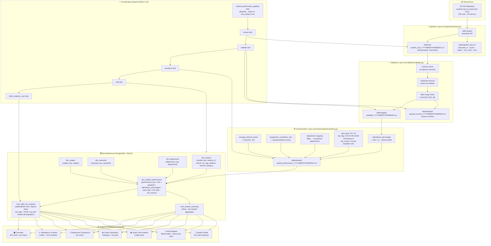
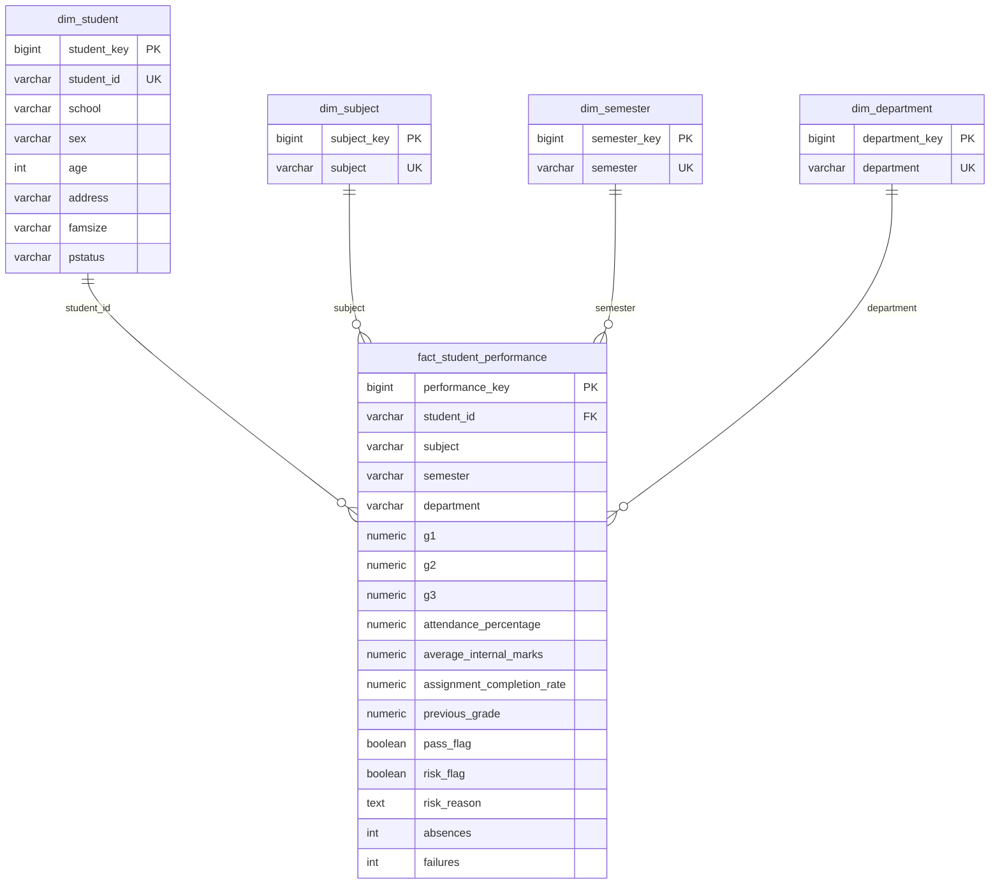

# Architecture Diagram – Student Performance Data Pipeline

## High-Level Pipeline Flow



## Technology Stack

| Layer | Technology |
|-------|-----------|
| Language | Python 3.11+ |
| Data manipulation | pandas 2.2 |
| Orchestration | Apache Airflow 2.10 (Docker or local) |
| Database | PostgreSQL 16 (primary) · SQLite (local fallback) |
| ORM / connection | SQLAlchemy 2.0 + psycopg2-binary |
| Dashboard | Streamlit 1.41 + Plotly 5.24 |
| Containerisation | Docker Compose (optional) |
| Testing | pytest 8 |
| Environment | python-dotenv |

## Data Layer Lineage

```
data/raw/           ← untouched timestamped copies from UCI
data/staging/       ← validated rows (schema OK, no duplicates, marks in range)
data/rejected/      ← rows with reason column explaining rejection
data/cleaned/       ← fully transformed analytical dataset
PostgreSQL/SQLite   ← star-schema warehouse + analytical marts
```

## Warehouse Star Schema


