# Architecture

```mermaid
flowchart LR
  UCI[UCI Student Performance CSV] --> E[Ingestion: Pandas]
  E --> R[data/raw]
  R --> A[Airflow DAG]
  A --> V[Validation and cleaning]
  V --> S[data/staging + rejected records]
  S --> T[Feature transformation]
  T --> C[data/cleaned]
  C --> P[(PostgreSQL star schema)]
  P --> M[Analytics materialized view]
  M --> D[Streamlit dashboard]
```

The raw, staging, rejected, and cleaned folders are lineage checkpoints. The warehouse is loaded idempotently by truncating and reloading the dimensions and fact table for each successful run.
